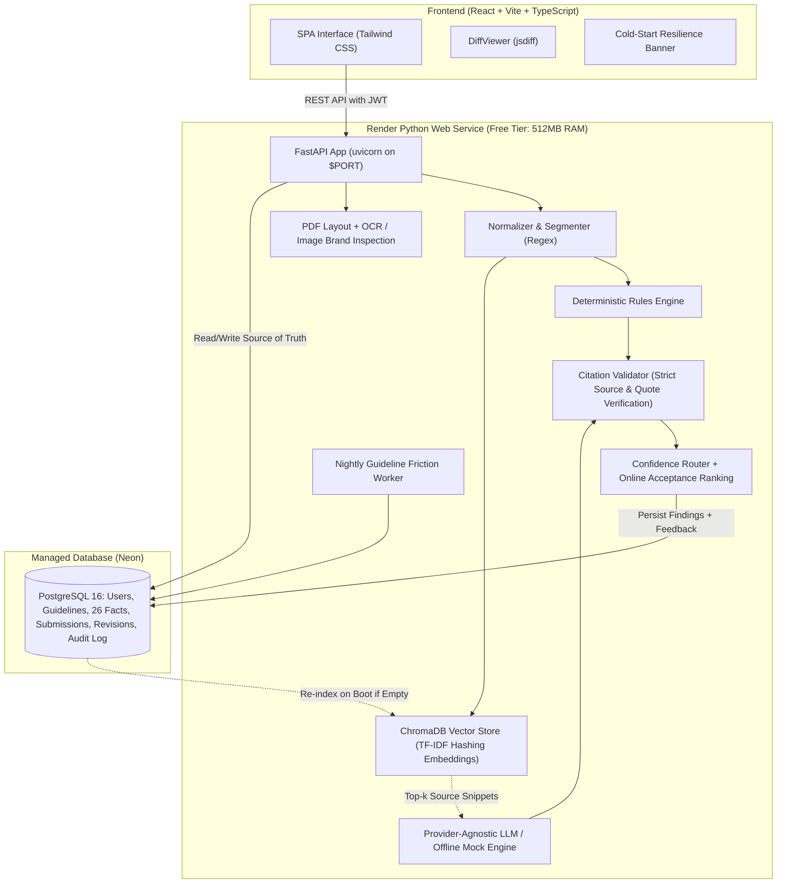

# BrandGuard

> **Pre-publication brand governance with explainable AI checks and humans in control.**
> Built by Team **Nexora** (Shweta Rahate, Janvi Thakre) for Round 2 of the Inkloom AI Hackathon.

BrandGuard sits between content drafting and publishing to review text, DOCX, PDF, PNG, JPEG, and SVG content against **approved brand sources only**. It detects tone deviations, banned terminology, unapproved messaging, factual discrepancies, outdated statistics, and text accessibility issues.

Every finding is **grounded in a cited source with an exact quote**, and suggested fixes are rendered as **word-level diffs** that preserve the creator's stated purpose.

---

## Architecture



---

## Key Features

1. **Grounded or Silent Engine**: Every finding cites an approved guideline clause, certified fact, or registered term with an exact quote. Ungrounded claims are dropped by the citation validator.
2. **Intent-Preserving Fixes with Word Diff**: Creators declare what their content is trying to achieve. Suggested fixes are verified against this purpose and displayed as word-level diffs (red strikethrough for removals, green for additions).
3. **Zero-Disruption Explicit Accept**: The AI never auto-edits or auto-publishes. Accepting a fix creates a clean new revision (`v+1`), preserving the audit trail.
4. **Outdated Fact Detection**: Identifies expired statistics (e.g. historical 2022 pricing or legacy renewable energy metrics) by comparing numbers against dated truth entries.
5. **Text-Level Accessibility**: Checks for vague link text (`[click here]`), missing image alt attributes in markdown/HTML, long all-caps blocks, and overly complex sentence structures.
6. **Multi-Role Governance Workflow**: Role-based access control (Creator, Brand Manager, Reviewer, Admin) with submission history, comments, and approval sign-off.
7. **Document Extraction**: Seamless text extraction from `.txt`, `.docx`, and `.pdf` uploads under 5 MB.
8. **Deterministic Offline Mode**: Fully functional with zero API keys required; seamless toggle to Anthropic Claude via environment variables.
9. **Guideline-Gap Insights**: A nightly job calculates a dispute-friction index for each clause. Managers can inspect the highest-friction clauses at `/dashboard/guideline-health`; active LLM providers draft proposed revisions for clauses above 30%.
10. **Image and Spatial PDF Review**: PNG, JPEG, and SVG uploads receive OCR, palette checks against colors in approved asset metadata, approved-logo matching, clear-space checks where a guideline specifies a measurable minimum, and detected-text contrast checks. PDF findings carry page coordinates, which the review screen highlights on the rendered page.
11. **Reviewer Feedback Loop**: Accept, edit, and dispute decisions train a persisted online logistic-regression model. Future rewrites are ranked by estimated acceptance probability; repeated disputed clause/span pairs are suppressed after three distinct findings. Suppression uses the current single-brand workspace because this deployment has no separate team table.

---

## Demo Accounts for Judges

When `DEMO_MODE=true`, the login screen shows these throwaway accounts and a one-click **Fill / Sign in** button for each role. The demo seed is the only code path that creates them; keep demo mode off for private workspaces.

| Role | Email | Password | Responsibilities |
| :--- | :--- | :--- | :--- |
| **Creator** | `creator@nexora.dev` | `CreatorDemo2026!` | Submits copy, declares intent, accepts/edits/disputes diff fixes |
| **Brand Manager** | `manager@nexora.dev` | `ManagerDemo2026!` | Company-wide visibility, reviews recurring mistakes, final sign-off |
| **Reviewer** | `reviewer@nexora.dev` | `ReviewerDemo2026!` | Compliance authority for health/regulatory claims and sensitive copy |
| **Admin** | `admin@nexora.dev` | `AdminDemo2026!` | Manages guidelines, users, settings, audit logs, and feedback model |

---

## Local Setup (No Docker)

Requires Python 3.12, Node.js 18+, npm, and Tesseract OCR (`brew install tesseract` on macOS; `sudo apt-get install tesseract-ocr` on Debian or Ubuntu). The backend defaults to a local SQLite database; Vite proxies `/api` requests to FastAPI, so local development needs no CORS configuration.

```bash
git clone https://github.com/shwetarahate13/BrandGuard.git
cd BrandGuard
cp .env.example .env
python3.12 -m venv .venv
source .venv/bin/activate
python -m pip install -r backend/requirements.txt
npm ci --prefix frontend
alembic upgrade head
```

With the default `DEMO_MODE=false`, create the first real administrator once. The password is entered through a hidden prompt and the command refuses to run if any user already exists:

```bash
python scripts/create_admin.py
```

Start the backend in one terminal from the repository root:

```bash
source .venv/bin/activate
uvicorn backend.app.main:app --host 127.0.0.1 --port 8000
```

Start the frontend in another terminal from the repository root:

```bash
npm run dev --prefix frontend -- --host 127.0.0.1 --port 5173
```

Open `http://127.0.0.1:5173`. To use demo data instead of creating a real admin, set `DEMO_MODE=true` in `.env` before running the backend. Run `npm run build --prefix frontend` to create a production SPA bundle.

### Render Free Runtime

`render.yaml` keeps the existing Docker deployment for Render because image review uses the Tesseract system package, which is not included in Render's native runtime. The Dockerfile builds the SPA, installs backend dependencies and Tesseract, then FastAPI serves the SPA on `$PORT`; `entrypoint.sh` runs `alembic upgrade head` before starting the server. `build.sh` remains available for a local/native production build. Set `DATABASE_URL` to PostgreSQL and keep the generated `JWT_SECRET`; the hackathon deployment sets `DEMO_MODE=true`, `IMAGE_REVIEW_ENABLED=true`, and `OCR_BACKEND=tesseract`.

The memory-intensive RapidOCR backend remains available with `OCR_BACKEND=rapidocr` for larger machines. The Render free configuration uses Tesseract to stay within the memory budget.

Docker files remain available for container-based deployment and are not needed for local setup.

---

## Environment Variables

| Variable | Default | Purpose |
| :--- | :--- | :--- |
| `DATABASE_URL` | `sqlite:///./brandguard.db` | PostgreSQL connection string (Neon in production) |
| `JWT_SECRET` | Generated per process in development | JWT signing secret; required in production |
| `JWT_EXPIRE_MINUTES` | `480` | JWT expiration interval |
| `LLM_PROVIDER` | `mock` | `mock` (offline deterministic) or `anthropic` |
| `LLM_MODEL` | `claude-sonnet-4-20250514` | Target LLM model name |
| `LLM_API_KEY` | `None` | Anthropic Claude API Key (optional) |
| `CHROMA_PERSIST_DIR` | `./data/chroma` | Persistent vector directory (`/tmp/chroma` on Render) |
| `ASSET_STORAGE_DIR` | `./data/assets` | Allowed local root for approved logo files referenced by asset records |
| `DEMO_MODE` | `false` | Seed throwaway accounts and expose demo sign-in controls |
| `IMAGE_REVIEW_ENABLED` | `false` | Enable image OCR and visual checks |
| `OCR_BACKEND` | `tesseract` | `tesseract` (lower-memory system package) or `rapidocr` (pip-only ONNX runtime) |
| `MAX_UPLOAD_SIZE_MB` | `5` | Maximum uploaded file size |
| `PORT` | `8000` locally | Web server port; Render supplies `$PORT` |
| `CORS_ORIGINS` | Empty | Comma-separated exact origin allowlist when hosting the UI separately |

---

## Running Tests and Evaluations

```bash
# Run full unit and integration test suite
pytest -v

# Run automated evaluation script against ground-truth fixtures
python scripts/eval.py

# Run production smoke test against running server or live URL
python scripts/smoke_test.py http://127.0.0.1:8000
```

---

## Project Documentation Directory

- [`docs/DEPLOYMENT.md`](docs/DEPLOYMENT.md): Click-by-click deployment guide for Render + Neon.
- [`docs/DEMO_SCRIPT.md`](docs/DEMO_SCRIPT.md): 3-minute click-by-click walkthrough for judges.
- [`docs/FEATURES.md`](docs/FEATURES.md): Working / Partial / Planned status of all features.
- [`docs/TECHNOLOGY.md`](docs/TECHNOLOGY.md): In-depth technical architecture and design decisions.
- [`docs/EVALUATION.md`](docs/EVALUATION.md): Precision, recall, and citation drop rate numbers.
- [`docs/LIMITATIONS.md`](docs/LIMITATIONS.md): Transparent disclosures and known limitations.
- [`docs/PLAN_CHANGES.md`](docs/PLAN_CHANGES.md): Full explanation of changes from Round 1.
- [`docs/ROUND3_IMPROVEMENTS.md`](docs/ROUND3_IMPROVEMENTS.md): The three delivered Round 3 improvements.
- [`docs/PROJECT_SUMMARY.md`](docs/PROJECT_SUMMARY.md): 1-2 page summary for project slide deck.
- [`docs/ASSUMPTIONS.md`](docs/ASSUMPTIONS.md): Recorded engineering assumptions.
