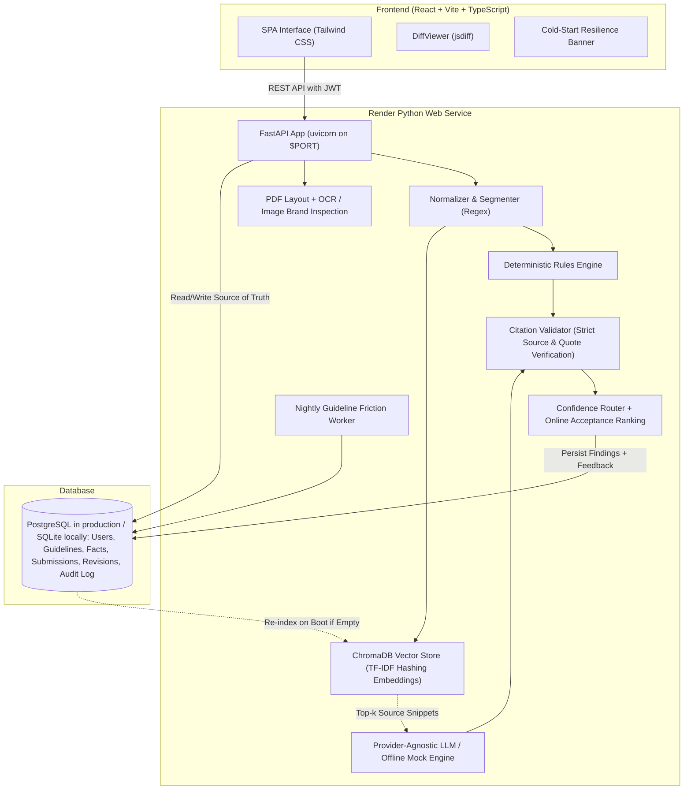

# BrandGuard

> **Pre-publication brand governance with explainable AI checks and humans in control.**
> Built by Team **Nexora** (Shweta Rahate, Janvi Thakre) for the Inkloom AI Hackathon.

BrandGuard sits between content drafting and publishing to review text, DOCX, PDF, PNG, JPEG, and SVG content against **approved brand sources only**. It detects tone deviations, banned terminology, unapproved messaging, factual discrepancies, outdated statistics, and text accessibility issues.

Every finding is **grounded in a cited source with an exact quote**, and suggested fixes are rendered as **word-level diffs** that preserve the creator's stated purpose.

---

## Architecture



---

## Key Features

1. **Grounded or Silent Engine**: Every finding cites an approved guideline clause, certified fact, or registered term with an exact quote. Ungrounded claims are dropped by the citation validator.
2. **Intent-Preserving Fixes with Word Diff**: Creators declare what their content is trying to achieve. Suggested fixes are verified against this purpose and displayed as word-level diffs (red strikethrough for removals, green for additions).
3. **Zero-Disruption Explicit Accept**: The AI never auto-edits or auto-publishes. Accepting a fix creates a clean new revision (`v+1`), preserving the audit trail.
4. **Outdated Fact Detection**: Identifies expired statistics (e.g. historical 2022 pricing or legacy renewable energy metrics) by comparing numbers against dated truth entries.
5. **Text-Level Accessibility**: Checks for vague link text (`[click here]`), missing image alt attributes in markdown/HTML, long all-caps blocks, and overly complex sentence structures.
6. **Multi-Role Governance Workflow**: Creator, Brand Manager, Reviewer, and Admin workspaces have distinct routes and permissions. Managers approve standard-risk copy; assigned reviewers approve high-risk copy. Self-approval is forbidden and admins cannot approve submissions.
7. **Document and Media Review**: Text extraction from `.txt`, `.docx`, and `.pdf` uploads; optional OCR and visual checks for `.png`, `.jpg`, `.jpeg`, and sanitized `.svg` uploads. Uploads are capped at 5 MB.
8. **Deterministic Offline Mode**: Fully functional with zero API keys required; seamless toggle to Anthropic Claude via environment variables.
9. **Guideline-Gap Insights**: A nightly UTC job calculates dispute friction for each clause. Managers and admins can recompute scores and inspect recurring disputes; a configured Anthropic provider can draft proposed revisions for clauses above the high-friction threshold.
10. **Image and Spatial PDF Review**: When `IMAGE_REVIEW_ENABLED=true`, image uploads receive OCR, approved-palette checks, logo matching, measurable clear-space checks, and detected-text contrast checks. PDF findings carry page coordinates, which the review screen highlights on the rendered page.
11. **Reviewer Feedback Loop**: Accept, edit, and dispute decisions train a persisted online logistic-regression model. Future rewrites are ranked by estimated acceptance probability; repeated disputed clause/span pairs are suppressed after three distinct findings. Suppression uses the current single-brand workspace because this deployment has no separate team table.
12. **Account and Operations Controls**: bcrypt password hashing, a 12-character password minimum, expiring JWTs, login lockout, request rate limits, role-scoped access, security headers, request IDs, and Alembic-managed schema changes.
13. **In-App Notifications**: Reviewer assignments notify the assigned reviewer; approval, changes-requested, and rejection decisions notify the creator. The persistent bell inbox tracks unread/read state and opens the relevant submission.

---

## Demo Accounts for Judges

When `DEMO_MODE=true`, the four throwaway accounts are created or synchronized on startup, and the login screen shows their credentials with a one-click **Fill / Sign in** button. Sample demo content is seeded only when the database is empty. With the default `DEMO_MODE=false`, the login page shows no demo credentials and no demo accounts are created. Create a real first admin with `python scripts/create_admin.py` instead. Never reuse the throwaway passwords for real accounts.

| Role | Email | Password | Responsibilities |
| :--- | :--- | :--- | :--- |
| **Creator** | `creator@nexora.dev` | `CreatorDemo2026!` | Submits copy, declares intent, accepts/edits/disputes diff fixes |
| **Brand Manager** | `manager@nexora.dev` | `ManagerDemo2026!` | Company-wide visibility, reviewer assignment, standard-risk sign-off, and guideline health |
| **Reviewer** | `reviewer@nexora.dev` | `ReviewerDemo2026!` | Assigned high-risk and escalated compliance review |
| **Admin** | `admin@nexora.dev` | `AdminDemo2026!` | Manages guidelines, users, settings, audit logs, and feedback model |

---

## Local Setup (No Docker)

Requires Python 3.12, Node.js 18+, and npm. Tesseract is needed only when enabling local image review (`brew install tesseract` on macOS; `sudo apt-get install tesseract-ocr` on Debian or Ubuntu). Image review is disabled by default. The backend defaults to a local SQLite database; Vite proxies `/api` requests to FastAPI, so local development needs no CORS configuration.

```bash
git clone https://github.com/shwetarahate13/BrandGuard.git
cd BrandGuard
cp .env.example .env
python3.12 -m venv .venv
source .venv/bin/activate
python -m pip install -r backend/requirements.txt
npm ci --prefix frontend
alembic upgrade head
```

With the default `DEMO_MODE=false`, create the first real administrator once. The password is entered through a hidden prompt and must be at least 12 characters. The command refuses to run if any user already exists:

```bash
python scripts/create_admin.py
```

Start the backend in one terminal from the repository root:

```bash
source .venv/bin/activate
uvicorn backend.app.main:app --host 127.0.0.1 --port 8000
```

Start the frontend in another terminal from the repository root:

```bash
npm run dev --prefix frontend -- --host 127.0.0.1 --port 5173
```

Open `http://127.0.0.1:5173`. To use demo data instead of creating a real admin, set `DEMO_MODE=true` in `.env` before running the backend. Run `npm run build --prefix frontend` to create a production SPA bundle.

### Render Free Runtime

`render.yaml` keeps the working Docker deployment for Render because image review uses the Tesseract system package, which is not installed by the native build. The Dockerfile builds the SPA, installs backend dependencies and Tesseract, then FastAPI serves the SPA on `$PORT`; `entrypoint.sh` runs `alembic upgrade head` before starting the server. `./build.sh` is available for a local or separately configured native environment with Node.js 18+: it installs backend requirements, builds the frontend, and applies Alembic migrations. Set `DATABASE_URL` to PostgreSQL and use the generated strong `JWT_SECRET`. The hackathon Render environment sets `DEMO_MODE=true`, `IMAGE_REVIEW_ENABLED=true`, and `OCR_BACKEND=tesseract`.

The optional RapidOCR backend is available with `OCR_BACKEND=rapidocr` for larger machines. Tesseract is the configured default and the Render deployment choice; its sample combined app/OCR memory measurement was about 299 MB. RapidOCR with OpenCV measured about 611 MB on the development Mac, so it is not selected for Render free.

Docker files remain available for container-based deployment and are not needed for local setup.

---

## Environment Variables

| Variable | Default | Purpose |
| :--- | :--- | :--- |
| `ENVIRONMENT` | `development` | Production mode enforces PostgreSQL and a strong JWT secret |
| `DATABASE_URL` | `sqlite:///./brandguard.db` | PostgreSQL connection string (Neon in production) |
| `JWT_SECRET` | Generated per process when unset in development | JWT signing secret; set a stable value of at least 32 bytes in production |
| `JWT_EXPIRE_MINUTES` | `480` | JWT expiration interval |
| `LLM_PROVIDER` | `mock` | `mock` (offline deterministic) or `anthropic` |
| `LLM_MODEL` | `claude-sonnet-4-20250514` | Target LLM model name |
| `LLM_API_KEY` | `None` | Anthropic Claude API Key (optional) |
| `CHROMA_PERSIST_DIR` | `./data/chroma` | Persistent vector directory (`/tmp/chroma` on Render) |
| `ASSET_STORAGE_DIR` | `./data/assets` | Allowed local root for approved logo files referenced by asset records |
| `DEMO_MODE` | `false` | Seed throwaway accounts and expose demo sign-in controls |
| `IMAGE_REVIEW_ENABLED` | `false` | Enable image OCR and visual checks |
| `OCR_BACKEND` | `tesseract` | `tesseract` (lower-memory system package) or `rapidocr` (pip-only ONNX runtime) |
| `MAX_UPLOAD_SIZE_MB` | `5` | Maximum uploaded file size |
| `MAX_TEXT_WORDS` | `5000` | Maximum words checked in one submission |
| `PORT` | `8000` locally | Web server port; Render supplies `$PORT` |
| `CORS_ORIGINS` | Empty | Comma-separated exact origin allowlist when hosting the UI separately |

Production requires `ENVIRONMENT=production` (or Render's production environment), a `JWT_SECRET` of at least 32 bytes, and a PostgreSQL `DATABASE_URL`. If `LLM_PROVIDER=anthropic`, also set `LLM_API_KEY`. Keep `DEMO_MODE=false` for private deployments.

---

## Running Tests and Evaluations

```bash
source .venv/bin/activate

# Run full unit and integration test suite
python -m pytest -v

# Run frontend API-client and saved-view regression tests
npm test --prefix frontend

# Run automated evaluation script against ground-truth fixtures
python scripts/eval.py

# Run production smoke test against running server or live URL
python scripts/smoke_test.py http://127.0.0.1:8000
```

---

## Project Documentation Directory

- [`docs/FEATURES.md`](docs/FEATURES.md): Implemented capabilities and current product boundaries.
- [`docs/ROUND3_IMPROVEMENTS.md`](docs/ROUND3_IMPROVEMENTS.md): Implementation and verification notes for Improvements A, B, and C.
- [`docs/LIMITATIONS.md`](docs/LIMITATIONS.md): Deployment, image-processing, data-scope, and security disclosures.
