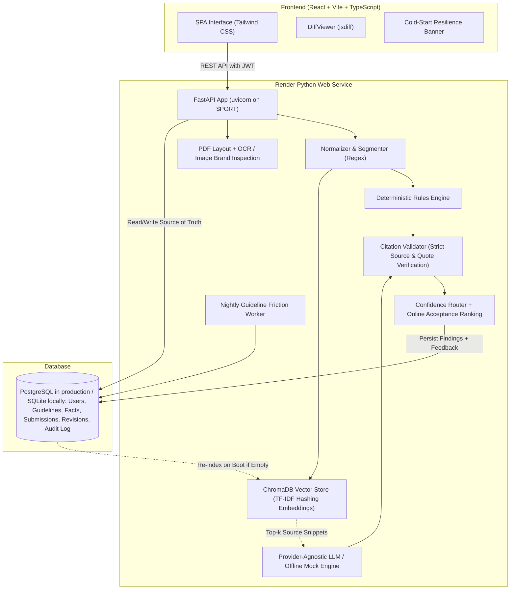

# BrandGuard

> **Pre-publication brand governance with explainable AI checks and humans in control.**
> Built by Team **Nexora** (Shweta Rahate, Janvi Thakre) for the Inkloom AI Hackathon.

## Run it locally in 5 minutes

Judges can run BrandGuard with Python 3.11+ on macOS, Linux, or Windows. The default lite install uses SQLite, seeded demo data, and the offline mock review engine. It needs no Docker, Node.js, hosted database, OCR package, or API key to run. FastAPI serves the committed production frontend bundle on the same port as the API.

### macOS / Linux

From a fresh clone, in the repository folder:

```bash
python scripts/setup_local.py
python scripts/doctor.py
python scripts/run_local.py
```

Use `python3` in place of `python` if that is how Python 3.11+ is installed on your computer. Setup creates `.venv`, installs pinned lite dependencies, writes a local `.env` with a generated `JWT_SECRET`, applies Alembic migrations, and seeds demo data. It does not overwrite a non-SQLite database with migrations.

### Windows PowerShell

```powershell
py -3.11 scripts/setup_local.py
py -3.11 scripts/doctor.py
py -3.11 scripts/run_local.py
```

The scripts use `.venv` automatically after setup; virtual-environment activation is not required. Use Python 3.11 or newer. Node.js 18+ is only needed for frontend development.

Expected startup output includes:

```text
Setup complete.
Start BrandGuard with: python scripts/run_local.py
Open: http://127.0.0.1:8000
Mode: lite; offline mock LLM; DEMO_MODE=true; SQLite
```

`run_local.py` prints `BrandGuard is starting at http://127.0.0.1:8000`. Open [http://127.0.0.1:8000](http://127.0.0.1:8000) to use the app. The health check is [http://127.0.0.1:8000/healthz](http://127.0.0.1:8000/healthz); API docs are at [http://127.0.0.1:8000/api/docs](http://127.0.0.1:8000/api/docs). Stop the server with Ctrl+C. To change ports, run `python scripts/run_local.py --port 8001`. To clear local SQLite, vector-index, and asset data before startup, run `python scripts/run_local.py --reset`.

The lite install does not include OCR/OpenCV. Uploading an image returns a clear message explaining that image review is not enabled. PDF text and spatial review remain available. For image review, run `python scripts/setup_local.py --full`; the full install enables the bundled RapidOCR backend. The local app and its mock review engine work offline after dependencies have been installed.

The seeded demo logins are:

| Role | Email | Password |
| :--- | :--- | :--- |
| Creator | `creator@nexora.dev` | `CreatorDemo2026!` |
| Brand Manager | `manager@nexora.dev` | `ManagerDemo2026!` |
| Reviewer | `reviewer@nexora.dev` | `ReviewerDemo2026!` |
| Admin | `admin@nexora.dev` | `AdminDemo2026!` |

For the short role-by-role walkthrough, open [the 5-minute Judge Guide](docs/JUDGE_GUIDE.md). It covers the local review path, finding fixes, four-role handoff, certificate download and public verification, plus the three improvements.

### Troubleshooting

| Problem | Fix |
| :--- | :--- |
| Python is older than 3.11 | Install Python 3.11+ and run setup with `python` (macOS/Linux) or `py -3.11` (PowerShell). |
| `doctor.py` reports missing packages | Run `python scripts/setup_local.py` again; use `--full` only if you need image review. |
| Port 8000 is busy | Stop the other process or use `python scripts/run_local.py --port 8001`. |
| Image review says it is not enabled | Run `python scripts/setup_local.py --full`, then restart the local server. |
| Demo credentials are not shown | Check that `.env` has `DEMO_MODE=true`, then restart the server. |
| Alembic cannot write the database | Keep `DATABASE_URL=sqlite:///./brandguard.db` and make the project folder writable. |

---

BrandGuard sits between content drafting and publishing to review text, DOCX, PDF, PNG, JPEG, and SVG content against **approved brand sources only**. It detects tone deviations, banned terminology, unapproved messaging, factual discrepancies, outdated statistics, and text accessibility issues.

Every finding is **grounded in a cited source with an exact quote**, and suggested fixes are rendered as **word-level diffs** that preserve the creator's stated purpose.

For step-by-step role instructions and feature explanations, see the [BrandGuard User Guide (PDF)](output/pdf/BrandGuard_User_Guide.pdf).

---

## Architecture



---

## Key Features

1. **Grounded or Silent Engine**: Every finding cites an approved guideline clause, certified fact, or registered term with an exact quote. Ungrounded claims are dropped by the citation validator.
2. **Intent-Preserving Fixes with Word Diff**: Creators declare what their content is trying to achieve. Suggested fixes are verified against this purpose and displayed as word-level diffs (red strikethrough for removals, green for additions).
3. **Zero-Disruption Explicit Accept**: The AI never auto-edits or auto-publishes. Accepting a fix creates a clean new revision (`v+1`), preserving the audit trail.
4. **Outdated Fact Detection**: Identifies expired statistics (e.g. historical 2022 pricing or legacy renewable energy metrics) by comparing numbers against dated truth entries.
5. **Text-Level Accessibility**: Checks for vague link text (`[click here]`), missing image alt attributes in markdown/HTML, long all-caps blocks, and overly complex sentence structures.
6. **Multi-Role Governance Workflow**: Creator, Brand Manager, Reviewer, and Admin workspaces have distinct routes and permissions. Managers approve standard-risk copy; assigned reviewers approve high-risk copy. Self-approval is forbidden and admins cannot approve submissions.
7. **Document and Media Review**: Text extraction from `.txt`, `.docx`, and `.pdf` uploads; optional OCR and visual checks for `.png`, `.jpg`, `.jpeg`, and sanitized `.svg` uploads. Uploads are capped at 5 MB.
8. **Deterministic Offline Mode**: Fully functional with zero API keys required; seamless toggle to Anthropic Claude via environment variables.
9. **Guideline-Gap Insights**: A nightly UTC job calculates dispute friction for each clause. Managers and admins can recompute scores and inspect recurring disputes; a configured Anthropic provider can draft proposed revisions for clauses above the high-friction threshold.
10. **Image and Spatial PDF Review**: When `IMAGE_REVIEW_ENABLED=true`, image uploads receive OCR, approved-palette checks, logo matching, measurable clear-space checks, and detected-text contrast checks. PDF findings carry page coordinates, which the review screen highlights on the rendered page.
11. **Reviewer Feedback Loop**: Accept, edit, and dispute decisions train a persisted online logistic-regression model. Future rewrites are ranked by estimated acceptance probability; repeated disputed clause/span pairs are suppressed after three distinct findings. Suppression uses the current single-brand workspace because this deployment has no separate team table.
12. **Account and Operations Controls**: bcrypt password hashing, a 12-character password minimum, expiring JWTs, login lockout, request rate limits, role-scoped access, security headers, request IDs, and Alembic-managed schema changes.
13. **In-App Notifications**: Reviewer assignments notify the assigned reviewer; approval, changes-requested, and rejection decisions notify the creator. The persistent bell inbox tracks unread/read state and opens the relevant submission.
14. **Tamper-Evident Approval Certificates**: Each submission has a SHA-256 hash-chained audit log protected from update/delete by SQLite/PostgreSQL triggers. Approval creates a downloadable PDF with the approved content hash, findings and resolutions, approvers, AI mode, and chain head. Public `/verify` checks integrity without showing content and compares a pasted published copy. Managers/admins can revoke with a required reason; admins can check and export every chain.

---

## Development and Deployment

To inspect audit integrity without starting the web app, run `python scripts/verify_audit_chain.py`. Use `python scripts/demo_tamper.py` after audit events exist to see a verifier catch a modified temporary database copy; it never changes the configured database. For known implementation boundaries, see [docs/LIMITATIONS.md](docs/LIMITATIONS.md).

Node.js 18+ and npm are needed only when changing the React frontend. For Vite development, install frontend dependencies and start the dev server while `run_local.py` serves the API:

```bash
npm ci --prefix frontend
npm run dev --prefix frontend -- --host 127.0.0.1 --port 5173
```

Open `http://127.0.0.1:5173`. Vite proxies API calls to the local FastAPI server. Build the committed production frontend with `npm run build --prefix frontend`, then copy `frontend/dist` to `backend/app/static` when updating the no-Node local bundle.

Docker Compose remains an optional alternative: copy `.env.example` to `.env`, set `POSTGRES_PASSWORD`, then run `docker compose up --build`. The judge path above does not use Docker.

### Render Runtime

`render.yaml` keeps the working Docker deployment for Render because image review uses the Tesseract system package, which is not installed by the native build. The Dockerfile builds the SPA, installs backend dependencies and Tesseract, then FastAPI serves the SPA on `$PORT`; `entrypoint.sh` runs `alembic upgrade head` before starting the server. `./build.sh` is available for a local or separately configured native environment with Node.js 18+: it installs backend requirements, builds the frontend, and applies Alembic migrations. Set `DATABASE_URL` to PostgreSQL and use the generated strong `JWT_SECRET`. The hackathon Render environment sets `DEMO_MODE=true`, `IMAGE_REVIEW_ENABLED=true`, and `OCR_BACKEND=tesseract`.

The optional RapidOCR backend is available with `OCR_BACKEND=rapidocr` for larger machines. Tesseract is the configured default and the Render deployment choice; its sample combined app/OCR memory measurement was about 299 MB. RapidOCR with OpenCV measured about 611 MB on the development Mac, so it is not selected for Render free.

Render continues to use the existing Docker runtime; it installs Tesseract and builds the frontend in its Node stage. Local judge setup does not change this deployment path.

---

## Environment Variables

| Variable | Default | Purpose |
| :--- | :--- | :--- |
| `ENVIRONMENT` | `development` | Production mode enforces PostgreSQL and a strong JWT secret |
| `DATABASE_URL` | `sqlite:///./brandguard.db` | PostgreSQL connection string (Neon in production) |
| `JWT_SECRET` | Generated per process when unset in development | JWT signing secret; set a stable value of at least 32 bytes in production |
| `JWT_EXPIRE_MINUTES` | `480` | JWT expiration interval |
| `LLM_PROVIDER` | `mock` | `mock` (offline deterministic) or `anthropic` |
| `LLM_MODEL` | `claude-sonnet-4-20250514` | Target LLM model name |
| `LLM_API_KEY` | `None` | Anthropic Claude API Key (optional) |
| `CHROMA_PERSIST_DIR` | `./data/chroma` | Persistent vector directory (`/tmp/chroma` on Render) |
| `ASSET_STORAGE_DIR` | `./data/assets` | Allowed local root for approved logo files referenced by asset records |
| `DEMO_MODE` | `true` in local setup | Seed throwaway accounts and expose demo sign-in controls |
| `BRANDGUARD_LITE` | `true` in local setup | Skip OCR/OpenCV dependencies and disable image review |
| `IMAGE_REVIEW_ENABLED` | `false` | Enable image OCR and visual checks |
| `OCR_BACKEND` | `tesseract` | `tesseract` (lower-memory system package) or `rapidocr` (pip-only ONNX runtime) |
| `MAX_UPLOAD_SIZE_MB` | `5` | Maximum uploaded file size |
| `MAX_TEXT_WORDS` | `5000` | Maximum words checked in one submission |
| `PORT` | `8000` locally | Web server port; Render supplies `$PORT` |
| `CORS_ORIGINS` | Empty | Comma-separated exact origin allowlist when hosting the UI separately |

Production requires `ENVIRONMENT=production` (or Render's production environment), a `JWT_SECRET` of at least 32 bytes, and a PostgreSQL `DATABASE_URL`. If `LLM_PROVIDER=anthropic`, also set `LLM_API_KEY`. Keep `DEMO_MODE=false` for private deployments.

---

## Running Tests and Evaluations

Run these commands from the repository root after installing the dependencies above. Activate `.venv` first, or use `.venv\Scripts\python.exe` in PowerShell when the environment is not activated.

```bash
# Backend unit and integration tests
python -m pytest -v

# Frontend API-client, saved-view, theme, and onboarding tests
npm test --prefix frontend

# Optional: run the evaluation script against its ground-truth fixtures
python scripts/eval.py

# Optional: run the smoke test against a running local server or URL
python scripts/smoke_test.py http://127.0.0.1:8000
```

The smoke test requires the backend to be running in another terminal. The evaluation script and smoke test supplement the automated test suites; they do not replace them.

---

## Project Documentation Directory

- [`docs/FEATURES.md`](docs/FEATURES.md): Implemented capabilities and current product boundaries.
- [`docs/ROUND3_IMPROVEMENTS.md`](docs/ROUND3_IMPROVEMENTS.md): Implementation and verification notes for Improvements A, B, and C.
- [`docs/LIMITATIONS.md`](docs/LIMITATIONS.md): Deployment, image-processing, data-scope, and security disclosures.
- [`docs/JUDGE_GUIDE.md`](docs/JUDGE_GUIDE.md): Five-minute role walkthrough and click path.
- [`docs/FEATURES.md`](docs/FEATURES.md): Implemented feature inventory, including certificates and audit integrity.
