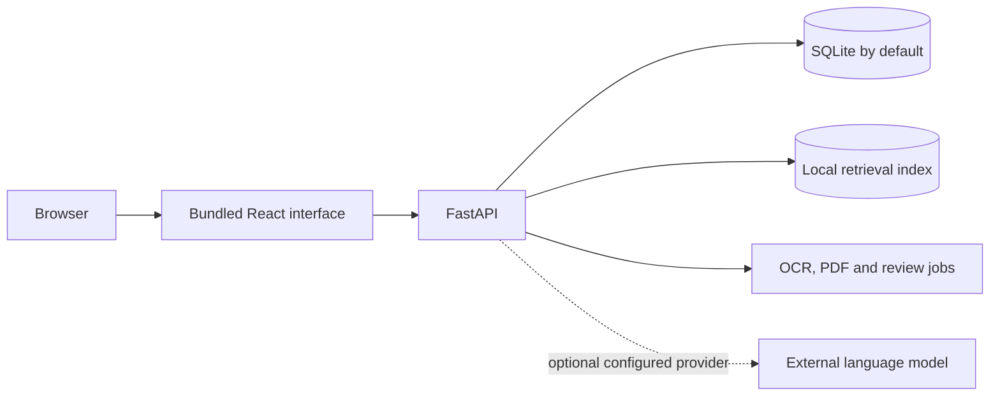

# BrandGuard

BrandGuard is a local-first brand governance workspace. Creators check and revise content, reviewers verify escalated claims, managers make final decisions, and admins manage users, sources, and audit records. The app runs offline in mock-LLM mode after setup; human reviewers make the compliance decisions.

## Feature summary

- Offline English spelling checks and conservative grammar rules, with cited writing findings and an admin-managed brand-word allowlist.
- Source-grounded guidance for terminology, tone, claims, facts, accessibility, and regulatory wording, with human-controlled suggestions, safe batch fixes, previews, rechecks, and version history.
- Role-based creator, manager, reviewer, and admin workspaces, including the three Round 3 improvements: Guideline-Gap Insights (A), Image Review and Format-Aware PDF Inspection (B), and Reinforcement Feedback Loop (C).

The writing rules are a focused aid, not a full grammar checker. See [docs/LIMITATIONS.md](docs/LIMITATIONS.md) for supported languages and other boundaries.

## Architecture



FastAPI serves the committed frontend bundle and API on one port. Alembic manages SQLite or configured PostgreSQL schema changes. The retrieval model and OCR runtime are local; an external language model is optional.

## Run locally

You need Python 3.11 or newer and several gigabytes of free disk space. Node.js and Docker are not needed to run BrandGuard. Clone once; keep that folder and pull updates into it instead of cloning again.

### macOS or Linux

1. Install Git and Python 3.11 or newer.
2. In Terminal, run:

   ```sh
   git clone https://github.com/shwetarahate13/BrandGuard.git
   cd BrandGuard
   python3 scripts/setup_local.py
   python3 scripts/run_local.py
   ```

   If `python3` points to a version older than 3.11, use the versioned command, such as `python3.12`, for both scripts.

### Windows PowerShell

1. Install Git and Python 3.11 or newer, with the Python launcher (`py`).
2. In PowerShell, run:

   ```powershell
   git clone https://github.com/shwetarahate13/BrandGuard.git
   Set-Location BrandGuard
   py -3.12 scripts/setup_local.py
   py -3.12 scripts/run_local.py
   ```

   Replace `3.12` with the Python version installed on your computer.

Setup creates the local virtual environment and `.env`, downloads the retrieval model for later offline use, applies migrations, and seeds demo data. It can take several minutes the first time. Open [http://localhost:8000](http://localhost:8000). Local setup enables `DEMO_MODE=true`, so the login page offers the four demo roles. Set `DEMO_MODE=false` in the local `.env` to disable demo accounts and demo data.

### Update an existing clone

Stop the running server with `Ctrl+C`, then open a terminal in the same `BrandGuard` folder and pull the latest code:

```sh
git pull --ff-only origin main
```

Start it again with `python3 scripts/run_local.py` on macOS/Linux or `py -3.12 scripts/run_local.py` in Windows PowerShell. The launcher applies pending database migrations. If Python dependencies changed, rerun `scripts/setup_local.py` with the same platform-specific Python command; your local `.env` and database are kept.

## Tests

Run the frontend checks from `frontend/`:

```sh
npm ci
npm test
npm run build
```

Run backend tests from the project root with `.venv/bin/python -m pytest -q` on macOS/Linux or `& .venv/Scripts/python.exe -m pytest -q` in PowerShell.

Run browser journeys from `frontend/` with `npm run test:e2e` after installing Chrome. They cover creator revision plus reviewer sign-off and manager approval.

## AI assistance

AI tools assisted implementation and documentation. BrandGuard defaults to deterministic offline review. A configured external language model may receive submitted text, intent, and retrieved source excerpts. People remain responsible for compliance decisions.

See [`docs/`](docs/) for the [architecture](docs/ARCHITECTURE.md), feature inventory, limitations, improvement details, roadmap, and judge guide.
