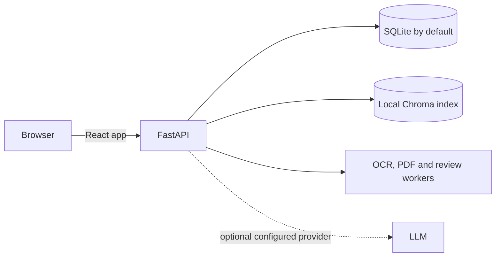

# BrandGuard

BrandGuard is a local-first brand and compliance review workspace. It checks copy and uploaded documents against approved guidance, records human decisions, and supports reviewer sign-off and manager approval. 

## Architecture



FastAPI serves the committed frontend bundle and JSON API on one local port. Alembic manages SQLite and PostgreSQL schema changes. The offline mock review mode needs no API key; neural retrieval warms in the background and falls back to a local hashing index if its model is unavailable.

## Clone and run

Install Python 3.11 or newer. On macOS or Linux, use the command for your installed minor version (for example, `python3.11`):

```sh
git clone https://github.com/shwetarahate13/BrandGuard.git
cd BrandGuard
python3.12 scripts/setup_local.py
python3.12 scripts/run_local.py
```

In Windows PowerShell, use `py -3.12 scripts/setup_local.py` followed by `py -3.12 scripts/run_local.py`. Replace `3.12` with the installed Python 3.11+ version in either example.

Open `http://localhost:8000`. Setup creates a virtual environment, installs pinned Python dependencies, downloads the retrieval model for offline use, creates a local `.env`, applies migrations, and seeds the local demo workspace. Node.js and Docker are not needed to run the app. Local setup enables `DEMO_MODE=true`; the login screen then shows the four throwaway demo accounts. Set `DEMO_MODE=false` in `.env` to disable demo accounts and sample data.

Run the doctor with the same Python launcher (`python3.12 scripts/doctor.py` on macOS/Linux or `py -3.12 scripts/doctor.py` in PowerShell). To run tests, use `.venv/bin/python -m pytest -q` on macOS/Linux or `& .venv/Scripts/python.exe -m pytest -q` in PowerShell.

## AI assistance

AI tools assisted development and documentation. The application defaults to deterministic offline review; an external language model is used only when explicitly configured. Human reviewers remain responsible for compliance decisions.

See [`docs/`](docs/) for the feature inventory, architecture, limitations, improvement details, and judge guide.
