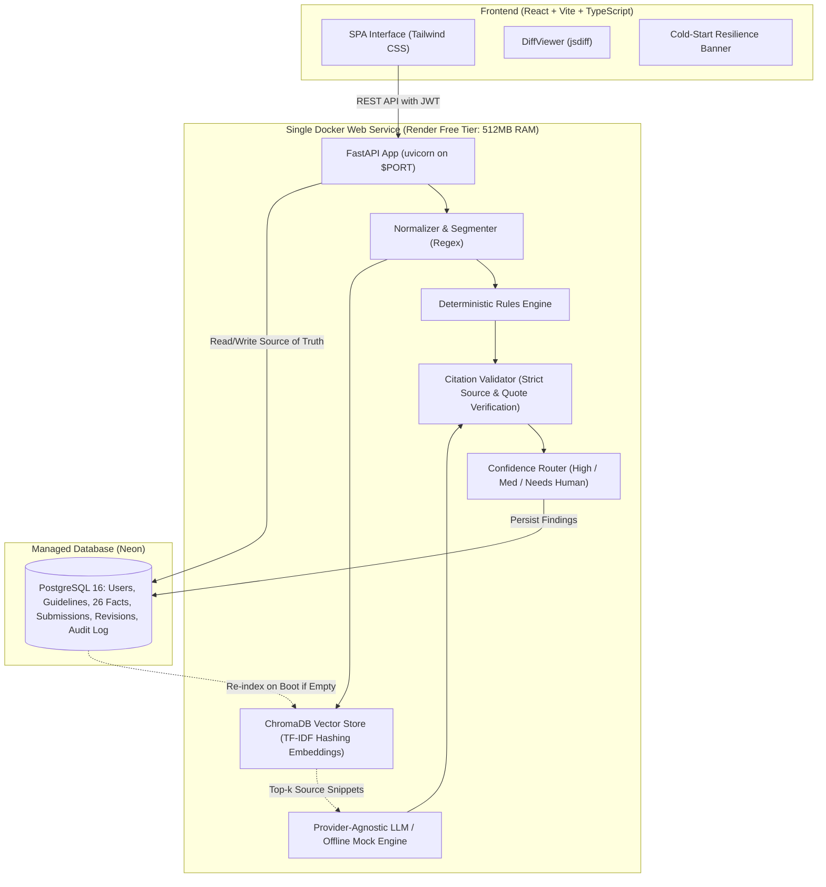

# BrandGuard

> **Pre-publication brand governance with explainable AI checks and humans in control.**
> Built by Team **Nexora** (Shweta Rahate, Janvi Thakre) for Round 2 of the Inkloom AI Hackathon.

BrandGuard sits between content drafting and publishing to review text, DOCX, and PDF content against **approved brand sources only**. It detects tone deviations, banned terminology, unapproved messaging, factual discrepancies, outdated statistics, and text accessibility issues.

Every finding is **grounded in a cited source with an exact quote**, and suggested fixes are rendered as **word-level diffs** that preserve the creator's stated purpose.

---

## Architecture



---

## Key Features

1. **Grounded or Silent Engine**: Every finding cites an approved guideline clause, certified fact, or registered term with an exact quote. Ungrounded claims are dropped by the citation validator.
2. **Intent-Preserving Fixes with Word Diff**: Creators declare what their content is trying to achieve. Suggested fixes are verified against this purpose and displayed as word-level diffs (red strikethrough for removals, green for additions).
3. **Zero-Disruption Explicit Accept**: The AI never auto-edits or auto-publishes. Accepting a fix creates a clean new revision (`v+1`), preserving the audit trail.
4. **Outdated Fact Detection**: Identifies expired statistics (e.g. historical 2022 pricing or legacy renewable energy metrics) by comparing numbers against dated truth entries.
5. **Text-Level Accessibility**: Checks for vague link text (`[click here]`), missing image alt attributes in markdown/HTML, long all-caps blocks, and overly complex sentence structures.
6. **Multi-Role Governance Workflow**: Role-based access control (Creator, Brand Manager, Reviewer, Admin) with submission history, comments, and approval sign-off.
7. **Document Extraction**: Seamless text extraction from `.txt`, `.docx`, and `.pdf` uploads under 5 MB.
8. **Deterministic Offline Mode**: Fully functional with zero API keys required; seamless toggle to Anthropic Claude via environment variables.

---

## Demo Accounts for Judges

The login screen features one-click quick-fill buttons for all four roles:

| Role | Email | Password | Responsibilities |
| :--- | :--- | :--- | :--- |
| **Creator** | `creator@nexora.dev` | `Creator123!` | Submits copy, declares intent, accepts/edits/disputes diff fixes |
| **Brand Manager** | `manager@nexora.dev` | `Manager123!` | Company-wide visibility, reviews recurring mistakes, final sign-off |
| **Reviewer** | `reviewer@nexora.dev` | `Reviewer123!` | Compliance authority for health/regulatory claims and sensitive copy |
| **Admin** | `admin@nexora.dev` | `Admin123!` | Manages guidelines (auto-split), 26 facts, terms, assets, and vector re-indexing |

---

## Local Setup in Under 5 Commands

### Option A: Local Python Virtual Environment

```bash
# 1. Clone repository
git clone https://github.com/shwetarahate13/BrandGuard.git 

# 2. Set up Python virtual environment and install dependencies
python3.12 -m venv .venv && source .venv/bin/activate
pip install -r backend/requirements.txt

# 3. Build React frontend
cd frontend && npm install && npm run build && cd ..

# 4. Run database migrations and seed demo data
alembic upgrade head
python scripts/generate_fixtures.py

# 5. Start BrandGuard server
uvicorn backend.app.main:app --host 127.0.0.1 --port 8000
```
Open [http://localhost:8000](http://localhost:8000) in your browser.

---

### Option B: Docker Compose

```bash
docker compose up --build
```
Open [http://localhost:8000](http://localhost:8000) in your browser.

---

## Environment Variables

| Variable | Default | Purpose |
| :--- | :--- | :--- |
| `DATABASE_URL` | `sqlite:///./brandguard.db` | PostgreSQL connection string (Neon in production) |
| `JWT_SECRET` | `dev-jwt-secret...` | Secret key for JWT session signature |
| `SECRET_KEY` | `dev-secret-key...` | Application secret key |
| `LLM_PROVIDER` | `mock` | `mock` (offline deterministic) or `anthropic` |
| `LLM_MODEL` | `claude-sonnet-4-20250514` | Target LLM model name |
| `LLM_API_KEY` | `None` | Anthropic Claude API Key (optional) |
| `EMBEDDING_BACKEND` | `tfidf` | `tfidf` (production default for 512MB RAM) |
| `CHROMA_PERSIST_DIR` | `./data/chroma` | Persistent vector directory (`/tmp/chroma` on Render) |
| `AUTO_SEED` | `true` | Idempotently seed Aurelia Foods brand kit and demo users |
| `PORT` | `8000` | Port for web server |

---

## Running Tests and Evaluations

```bash
# Run full unit and integration test suite (15 tests)
pytest -v

# Run automated evaluation script against ground-truth fixtures
python scripts/eval.py

# Run production smoke test against running server or live URL
python scripts/smoke_test.py http://127.0.0.1:8000
```

---

## Project Documentation Directory

- [`docs/DEPLOYMENT.md`](file:///Users/shwetarahate/Downloads/BrandGuard-2/docs/DEPLOYMENT.md): Click-by-click deployment guide for Render + Neon.
- [`docs/DEMO_SCRIPT.md`](file:///Users/shwetarahate/Downloads/BrandGuard-2/docs/DEMO_SCRIPT.md): 3-minute click-by-click walkthrough for judges.
- [`docs/FEATURES.md`](file:///Users/shwetarahate/Downloads/BrandGuard-2/docs/FEATURES.md): Working / Partial / Planned status of all features.
- [`docs/TECHNOLOGY.md`](file:///Users/shwetarahate/Downloads/BrandGuard-2/docs/TECHNOLOGY.md): In-depth technical architecture and design decisions.
- [`docs/EVALUATION.md`](file:///Users/shwetarahate/Downloads/BrandGuard-2/docs/EVALUATION.md): Precision, recall, and citation drop rate numbers.
- [`docs/LIMITATIONS.md`](file:///Users/shwetarahate/Downloads/BrandGuard-2/docs/LIMITATIONS.md): Transparent disclosures and known limitations.
- [`docs/PLAN_CHANGES.md`](file:///Users/shwetarahate/Downloads/BrandGuard-2/docs/PLAN_CHANGES.md): Full explanation of changes from Round 1.
- [`docs/ROUND3_IMPROVEMENTS.md`](file:///Users/shwetarahate/Downloads/BrandGuard-2/docs/ROUND3_IMPROVEMENTS.md): The three major planned Round 3 improvements.
- [`docs/PROJECT_SUMMARY.md`](file:///Users/shwetarahate/Downloads/BrandGuard-2/docs/PROJECT_SUMMARY.md): 1-2 page summary for project slide deck.
- [`docs/ASSUMPTIONS.md`](file:///Users/shwetarahate/Downloads/BrandGuard-2/docs/ASSUMPTIONS.md): Recorded engineering assumptions.
