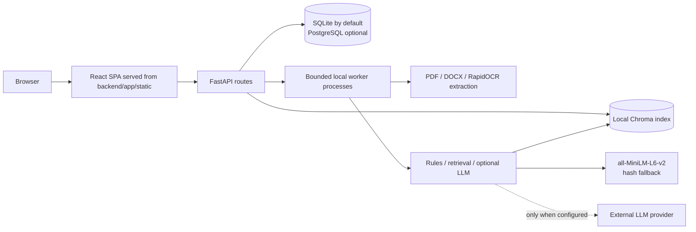

# Architecture

BrandGuard is a local-first single-workspace application. FastAPI serves both the JSON API and the committed React application, so the normal runtime uses one local process and port.

## Main components

- `frontend/` contains the React, TypeScript, Tailwind, and Vite source. `frontend/dist/` is copied to `backend/app/static/` and committed so judges can run the app without Node.js.
- `backend/app/api/` contains authentication, submission, finding, workflow, guideline, feedback, report, notification, certificate, and admin routes. Role checks are centralized in `services/permissions.py`.
- `backend/app/pipeline/` performs deterministic writing and compliance checks, source retrieval, rewrite safety, confidence scoring, and preference learning. Neural retrieval loads in the background; the labelled hashing fallback remains available.
- PDF/DOCX extraction and image OCR use bounded worker processes. Uploaded source bytes and layout coordinates are stored with immutable submission versions. Local image OCR uses RapidOCR without system packages.
- SQLAlchemy models are migrated only through Alembic. SQLite is the default; PostgreSQL can be selected with `DATABASE_URL`. ChromaDB stores the local approved-source vector index and can be rebuilt from database records.

## Local operation

`python scripts/setup_local.py` creates the environment, installs pinned dependencies, downloads the retrieval model, migrates the database, and seeds fictional demo data when enabled. `python scripts/run_local.py` starts the local service and serves the prebuilt UI. The default provider is a mock, so the complete local workflow does not require a network API key after setup.

The optional live language-model integration may send copy, intent, and retrieved source excerpts to the configured provider. Review provider terms before using sensitive content. The project is not designed for multi-user hosting: rate limits, scheduled work, retrieval state, and background-job progress are process-local.
